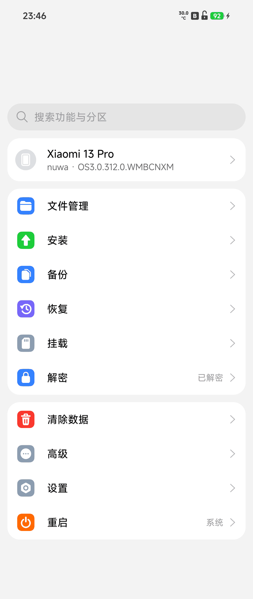
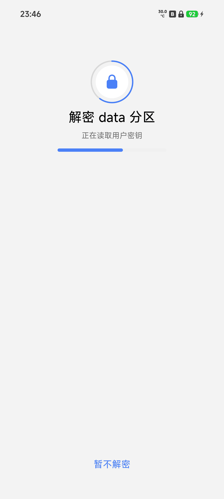
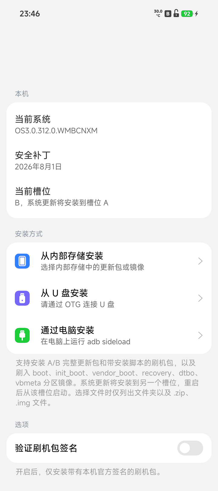
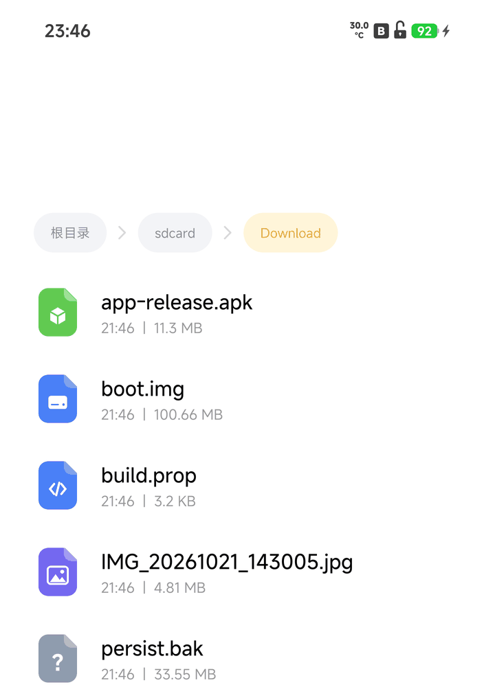
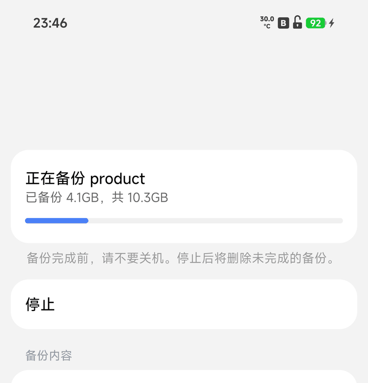
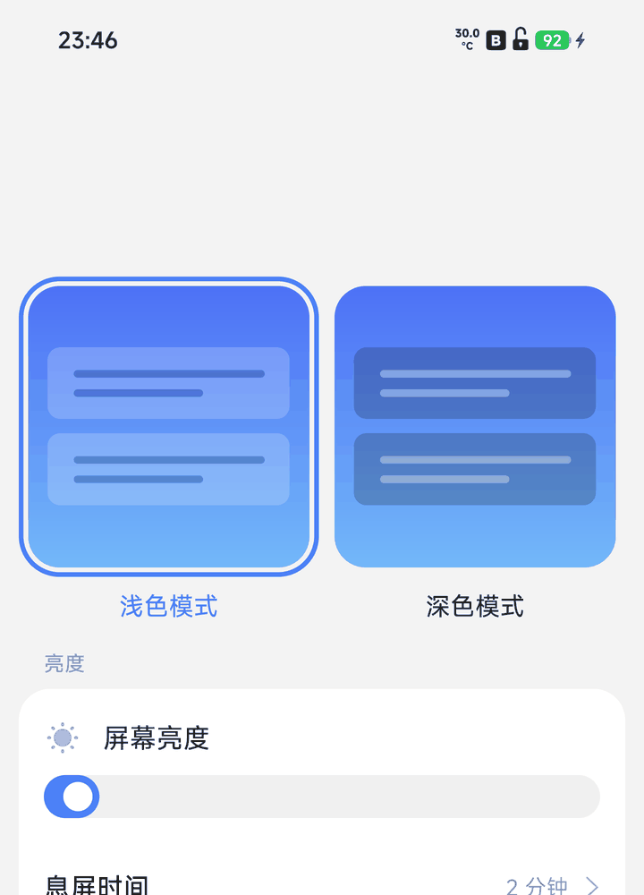

# Skyward for nuwa

English | [简体中文](README.zh-CN.md)

Skyward is a recovery for Android phones, written from scratch in Rust: no
TWRP tree, no AOSP recovery, no Java. It boots from the recovery partition as
the stock one does, draws its own interface, and does the work a recovery is
for — opening the data partition, installing packages, backing up partitions,
wiping, mounting, and handing the storage to a computer.

This repository carries Skyward to one phone: the **Xiaomi 13 Pro**
(codename `nuwa`), on top of upstream
[kirklin/skyward](https://github.com/kirklin/skyward) 0.3.0. The port and its
upkeep are by **[xiuxiu391](https://github.com/xiuxiu391)**.

<table>
  <tr>
    <td align="center"></td>
    <td align="center"></td>
    <td align="center"></td>
  </tr>
  <tr>
    <td align="center">Home: the phone's state, and every way in</td>
    <td align="center">Decrypt: hardware-wrapped keys, in five steps</td>
    <td align="center">Install: internal storage, a stick, or a computer</td>
  </tr>
  <tr>
    <td align="center"></td>
    <td align="center"></td>
    <td align="center"></td>
  </tr>
  <tr>
    <td align="center">Files: internal storage, a stick, the partitions</td>
    <td align="center">Backup: each part counted, the whole checked</td>
    <td align="center">Settings: theme, language, time zone, screen-off</td>
  </tr>
</table>

> The pictures are drawn by the preview tool in this repository from this
> phone's own configuration (`cargo run -p skyward-preview`), not taken from
> another device.

## What it does

- **Opens the data partition**: starts the phone's own key programs from the
  descriptions its partitions carry — the listener, keymint, gatekeeper,
  weaver, the secure element — and takes the hardware-wrapped key; file-based
  encryption, and the users' own files behind their screen lock.
- **Installs** zips, full system update packages and partition images, from
  internal storage, a USB drive or `adb sideload`.
- **Backs up and restores** partitions and files, with a check of each backup.
- **Wipes** data, and formats or repairs filesystems.
- **Mounts** the slot's partitions, and switches slots.
- **Files and a terminal**: a file manager, a shell, and the kernel log.
- **Hands storage to a computer** over MTP, and speaks adb and fastbootd.
- **WLAN**, joining the network kept at the next start by itself.
- **Wireless transfer**: a browser on the same network opens
  `http://<phone>:8080/` to list, download and drop files onto the phone.
- **Downloads from an address**: straight into `Download/`, resumed when
  stopped; a code on the page (8081) takes an address typed on another phone,
  and `link.txt` takes one a computer left.
- **Two systems** on one phone, from the Dual boot page.
- **Updates itself** from its own releases.
- Light and dark themes; Simplified Chinese, Traditional Chinese and English;
  the volume keys go through every page.

## What this release brings

**Memory stands in for internal storage when data cannot be opened.** A
partition emptied by a factory reset, one no system has built yet, or one that
will not open leaves nowhere to put a package. The recovery now shows a piece
of the phone's memory at `/sdcard` — three quarters of what is free, never less
than 8 GB, a ceiling rather than an asking — with `Download` and
`Pictures/Screenshots` made in it. Internal storage is writable again, so the
wireless transfer, MTP and the file manager can bring a package in, and it can
be flashed. A restart empties it, and the page says so. A phone whose data is
fine never sees it.

**Formatting data does the half that is safe here.** It empties the partition,
throws the old key away and makes the filesystem; the key is left to the system
that starts next, because this phone's secure world does not survive being
asked for one from the recovery (the whole phone went down under the request,
twice). Flash a system, start it, and data is built.

**The key programs come from the phone's own partitions.** `/vendor`, `/odm`,
`/system_ext` and `/system/etc/init/*.rc` say which programs the key service is
made of, and the recovery starts them as init would; what the configuration
says of the same kind gives way. Another system version, or a ported ROM, still
lines up.

**Keys across builds.** `devices/nuwa.toml` names `build_release = "17"` and
`build_patch = "2099-12-31"` for both the system's properties and the vendor's,
so a key made by a newer system is not refused with `-62`.

**The rest is this fork's own**: the wireless transfer on 8080, the code on the
download page at 8081 with `link.txt`, the WLAN address kept or made, the
screen lock remembered, the touchscreen woken with the panel, and a partition
in use taken off the tree instead of stopping an install.

## What has been seen on this phone

| | State |
| --- | --- |
| Booting, the interface, touch, volume keys, screenshots | verified |
| Flashing both slots, then starting | verified (v2.0.1: `nuwa 2.0.1 recovery up`, and an empty misc lands on the home page) |
| Opening the data partition | verified (keys made by Android 17, phone on 16) |
| Key programs started from the partitions' descriptions | verified (qseecomd / ssgtzd / keymint / hwservicemanager / gatekeeper / boot) |
| adb, fastbootd, MTP | verified |
| Wireless transfer on 8080, the code on 8081 | built and previewed |
| Memory standing in for internal storage (3/4, 8 GB at least) | verified: `tmpfs 8.0G /sdcard`, `adb push` into `Download/` |
| Installing, backup and restore, Dual boot, online updates | inherited from upstream, not yet exercised on this phone |

## Getting it onto the phone

An unlocked bootloader is the only prerequisite. Download the zip from
[Releases](https://github.com/pubglite55/skyward-for-nuwa/releases) — published
from tags named `nuwa-v*`, each file named
`skyward-nuwa-<version>-<stock build>` — check it against `SHA256SUMS.txt`,
unzip it, and flash the image inside to both slots:

```sh
unzip skyward-nuwa-v2.0.1-OS3.0.312.0.WMBCNXM.zip
fastboot flash recovery_a skyward-nuwa-v2.0.1-OS3.0.312.0.WMBCNXM.img
fastboot flash recovery_b skyward-nuwa-v2.0.1-OS3.0.312.0.WMBCNXM.img
fastboot reboot recovery
```

From then on a newer image, unzipped, installs from Skyward's own Install page.
With **Flash Skyward again** on, a system update or a zip that writes over the
recovery partition puts Skyward back in it.

Nothing of the system is touched by flashing recovery, and OTA updates go on
working; flashing the stock recovery back is all it takes to return to it.

## The pages

| Page | What it is for |
| --- | --- |
| Home | The phone's state, and the way into everything else |
| Decrypt | What keeps the data partition closed, and the field for the password when a user's own files need one |
| Files | The file manager, over internal storage, a USB drive and the slot's partitions |
| Install | Packages and images: from a place, from a USB drive, or from `adb sideload` |
| Backup | Partitions and files into a backup |
| Restore | Parts of a backup written back |
| Mount | The slot's partitions, mounted, unmounted, formatted, repaired |
| Wipe | Data, cache, and the phone's own logs |
| Dual boot | A second system in the data partition, installed, switched to, removed |
| Wireless | Internal storage handed to a browser on the same network: list, download, upload |
| Download | An address taken into `Download/`, resumed when stopped; a code or `link.txt` brings one |
| Advanced | A terminal, the kernel log, SELinux contexts, filesystems, updates, the wireless switches |
| Settings | Theme, language, time zone, screen-off time, vibration, file transfer |
| Reboot | System, recovery, fastboot, bootloader, EDL, and the slot to boot |
| About | The version, the phone, and where the project comes from |

## Decryption

The data partition opens on demand: the file manager opens it when entered, and
an update that needs `/data` opens it before reading it. Where no screen lock is
set it opens by itself; where one is, the page asks for it. The metadata key is
wrapped by the phone's hardware and needs nothing typed.

A key is measured against the build it was made under, and a key made by a newer
build than the one installed is refused until it is renewed — a renewal a key of
a newer build never gets. This phone's data was made by HyperOS 4 (Android 17,
patch level 2099-12-31), so `devices/nuwa.toml` names that build:

```toml
build_release = "17"
build_patch = "2099-12-31"
```

The patch level is reported for the system's properties and the vendor's alike,
because the vendor build is the one a key is measured against. Should the phone
be reset from a newer system, those two lines have to name that system's build.
The log then says which generation the key was made in, and whether the
partition opened:

```
skyward: ro.vendor.build.security_patch speaks for the configuration's 2099-12-31, not the installed system's 2025-08-01
skyward: the data partition is open: f2fs at /data
```

## When something goes wrong

**The data partition stays closed.** Read the `generation N` in the log line
above: the key was made by a build of that generation, and the recovery has to
speak for it. That is what `build_release` and `build_patch` in
`devices/nuwa.toml` are for.

**The partition is empty and nothing opens.** The recovery shows memory as
internal storage; install a system first. Once it starts, the system builds data
itself.

**It asks for a password.** The users' own files are behind their screen lock;
the password is the one the phone boots with. The partition itself opens
without it.

**Skyward is gone after a system update.** Turn on **Flash Skyward again** in
Settings, or flash the image again; a stock OTA rewrites the recovery partition.

**Nothing boots, but the phone is fine.** Hold power and volume up for recovery,
or power and volume down for fastboot. With no system in super, Skyward still
starts with its screen, keys, adb and fastbootd — enough to install one.

**A package stops because a partition is in use.** It no longer does: the
partitions the recovery's own key, touch and WLAN programs hold are taken off
the tree before the write, and the log says `came off the tree at once`.

**The computer cannot see the phone.** Device Manager shows
`Android Composite ADB Interface` and `adb devices` is still empty: the adb
server that has been running on the computer holds the device's handle, and its
own log says `Failed to open device handle ... Error [5]: access denied`. End
every adb process and start one again; the phone stays untouched:

```sh
taskkill /F /IM adb.exe
adb start-server
```

**The boot log says the WLAN did not come up.** That is
`the WLAN did not come up: ... No such device`: the driver modules had just
been loaded and the interface was not registered yet, so the one look at start
found nothing. `wlan0` is there a moment later, and the WLAN page scans and
joins as usual.

**adb reaches the storage without authorization.** This is by design: adb in
Skyward is a root shell that asks nothing. Anyone with the phone and a cable
reaches its storage while it is in recovery.

## Building

The build needs the stable Rust that `rust-toolchain.toml` names, its
`aarch64-linux-android` target, the Android NDK r29 and
[cargo-ndk](https://github.com/bbqsrc/cargo-ndk). The image is built on the
stock recovery of the build `devices/nuwa.toml` names, taken from Xiaomi's own
update package and checked against its SHA-256. Commands, tests and the preview
tool are in [docs/BUILDING.md](docs/BUILDING.md).

## Where it comes from

Skyward is [kirklin/skyward](https://github.com/kirklin/skyward), by kirklin and
its contributors; the port to this phone and its upkeep are by **xiuxiu391**,
on top of upstream 0.3.0. Licensed under
[GPL-3.0-or-later](LICENSE).
