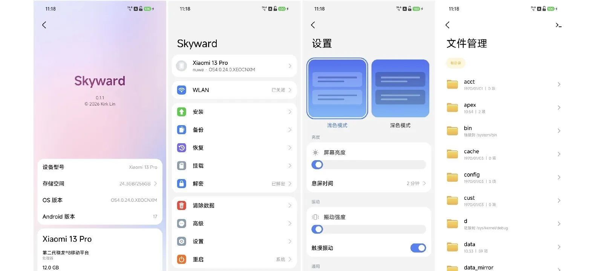

# Skyward for nuwa

[English](README.md) | 简体中文

Skyward 是用 Rust 从零编写的 Android recovery：没有 TWRP 的框架，不基于 AOSP recovery，也没有 Java。它像原厂 recovery 一样从 recovery 分区启动，自己绘制界面，做 recovery 该做的事 —— 打开 data 分区、安装刷机包、备份分区、清除数据、挂载分区，以及把存储交给电脑。

这个仓库把它带到一台手机上：**小米 13 Pro**（代号 `nuwa`）。上游支持的其它机型见 [kirklin/skyward](https://github.com/kirklin/skyward)。



<p align="center">
  
  
  
</p>

## 它能做什么

- **打开 data 分区**：通过手机自己的密钥服务取硬件包裹的密钥，支持文件级加密，以及锁屏保护的用户个人文件。
- **安装**刷机包、完整系统更新包和分区镜像，来源可以是内部存储、U 盘或 `adb sideload`。
- **备份与恢复**分区和文件，每个备份都会校验。
- **清除数据**，格式化和修复文件系统。
- **挂载**当前槽位的分区，切换槽位。
- **文件管理与终端**：文件管理器、shell 和内核日志。
- **把存储交给电脑**（MTP），同时提供 adb 和 fastbootd。
- **连接 WLAN**，记住了密码的会在开机时自己连上，直接从网络检查更新。
- **浏览器**（高级 → 浏览器）：自带标题页与搜索框，输入网址或词句；网页的文字、链接与图片（PNG/JPEG）都显示出来。不执行脚本，SVG/WebP 图不显示。
- **无线传输**：同一网段的电脑用浏览器打开 `http://手机地址:8080/`，列目录、下载、拖放上传。
- **网络下载**：输入直链即下到 `Download/`，可续传；地址太长时用另一台手机扫页面上的码（8081）输入，或读 `link.txt`。
- **双系统**：在 data 分区里养第二个系统。
- **自我更新**：从自己的 Releases 安装新版本。
- 浅色与深色主题；简体中文、繁体中文和英文。

| | 在这台手机上 |
| --- | --- |
| 启动、界面、触摸、按键 | 已验证 |
| 打开 data 分区 | 已验证（密钥由 Android 17 写出，手机运行 16） |
| adb | 已验证 |
| 安装、MTP、fastbootd、WLAN、备份与恢复、双系统、在线更新 | 继承自 0.2.0，尚未在此机型上实测 |
| WLAN 自动连接与记住密码、下载页二维码、浏览器 | 构建与单元测试通过，界面待目视 |

## 刷入

只需要已解锁的 bootloader。从 [Releases](https://github.com/pubglite55/skyward-for-nuwa/releases) 下载 zip（由 `nuwa-v*` 标签发布，文件名形如 `skyward-nuwa-<版本>-<原厂版本>`），用 `SHA256SUMS.txt` 核对，解压后把其中的镜像刷入手机当前槽位的 recovery 分区：

```sh
unzip skyward-nuwa-v1.6-OS3.0.312.0.WMBCNXM.zip
fastboot flash recovery_a skyward-nuwa-v1.6-OS3.0.312.0.WMBCNXM.img
fastboot flash recovery_b skyward-nuwa-v1.6-OS3.0.312.0.WMBCNXM.img
fastboot reboot recovery
```

之后新版本解压后可以直接在 Skyward 的「安装」页刷入。打开 **自动重新刷入 Skyward** 之后，系统更新或覆盖 recovery 分区的刷机包会把 Skyward 刷回去。

刷 recovery 不会改动系统，OTA 也照常可用；要回到原厂 recovery，刷回原厂镜像即可。

## 页面

| 页面 | 用途 |
| --- | --- |
| 解密 | 说明数据分区为什么还关着；需要时提供输入锁屏密码的地方 |
| 主页 | 手机状态，以及通往其它页面的入口 |
| 文件 | 文件管理器，覆盖内部存储、U 盘和当前槽位的分区 |
| 安装 | 刷机包与镜像：从某个位置、U 盘或 `adb sideload` |
| 备份 | 把分区和文件备份，以及从备份恢复 |
| 挂载 | 当前槽位的分区：挂载、卸载、格式化、修复 |
| 清除 | 数据、缓存，以及手机自己的日志 |
| 双系统 | 在 data 分区里安装、切换、移除第二个系统 |
| 无线传输 | 把内部存储交给同一网段的浏览器：列目录、下载、上传 |
| 网络下载 | 从直链下载到 `Download/`，可续传；二维码或 `link.txt` 送地址 |
| 浏览器 | 图形化的地址栏与标题页；网页的文字、链接与图片，点链接继续 |
| 工具 | 终端、内核日志、recovery 自己的日志 |
| 设置 | 主题、语言、时区、息屏时间、振动、文件传输 |
| 重启 | 系统、recovery、fastboot、bootloader、EDL，以及启动哪个槽位 |
| 关于 | 版本、手机信息、项目来源 |

## 解密

数据分区是**按需打开**的：进入文件管理时打开，需要读写 `/data` 的更新安装也会先打开它。没有设置锁屏时自动打开，设置了锁屏时会询问。metadata 的密钥由手机硬件包裹，不需要输入任何东西。

密钥按照**它被造出来时的构建**来度量，比当前系统更新的密钥会被拒绝使用，直到续期 —— 而更新构建的密钥永远得不到续期。这台手机的数据由 HyperOS 4（Android 17，补丁级 2099-12-31）写出，所以 `devices/nuwa.toml` 声明了那个构建：

```toml
build_release = "17"
build_patch = "2099-12-31"
```

补丁级同时报给系统属性和 **vendor** 属性，因为密钥是对着 vendor 构建度量的。如果手机以后被更新的系统重置过，这两行就要改成那个系统的构建。日志里会写明密钥的代际，以及分区是否打开：

```
skyward: ro.vendor.build.security_patch speaks for the configuration's 2099-12-31, not the installed system's 2025-08-01
skyward: the data partition is open: f2fs at /data
skyward: the data partition stays closed: ... it was made by key format generation 4 ...
```

## 出问题时

**数据分区一直关着。** 看上面日志里的 `generation N`：密钥是由那个代际的构建造出来的，recovery 必须为那个构建说话 —— 这就是 `devices/nuwa.toml` 里 `build_release` 和 `build_patch` 的作用。

**它要求输入密码。** 那是用户个人文件的锁屏密码，就是开机时用的那个；分区本身不需要密码就能打开。

**系统更新之后 Skyward 没了。** 在设置里打开 **自动重新刷入 Skyward**，或者重新刷一次镜像 —— 原厂 OTA 会重写 recovery 分区。

**开不了机，但手机没坏。** 电源 + 音量上进入 recovery，电源 + 音量下进入 fastboot。super 里没有系统时 Skyward 依然能启动，屏幕、按键、adb 和 fastbootd 都在，足够装回一个系统。

**adb 不用授权就能访问存储。** 这是设计如此：Skyward 里的 adb 是不需要确认的 root shell。手机处于 recovery 时，任何人拿到手机和数据线都能访问其中的存储。

## 构建

构建需要 `rust-toolchain.toml` 指定的稳定版 Rust、它的 `aarch64-linux-android` 目标、Android NDK r29 和 [cargo-ndk](https://github.com/bbqsrc/cargo-ndk)。镜像基于 `devices/nuwa.toml` 指定的原厂 recovery 构建，从小米自己的更新包里取出并核对 SHA-256。命令、测试和预览工具见 [docs/BUILDING.md](docs/BUILDING.md)。

## 来源

Skyward 来自 [kirklin/skyward](https://github.com/kirklin/skyward)，作者 kirklin 及其贡献者；这个分支跟随 0.2.0，保留本机型的配置与解密工作。许可证为 [GPL-3.0-or-later](LICENSE)。
